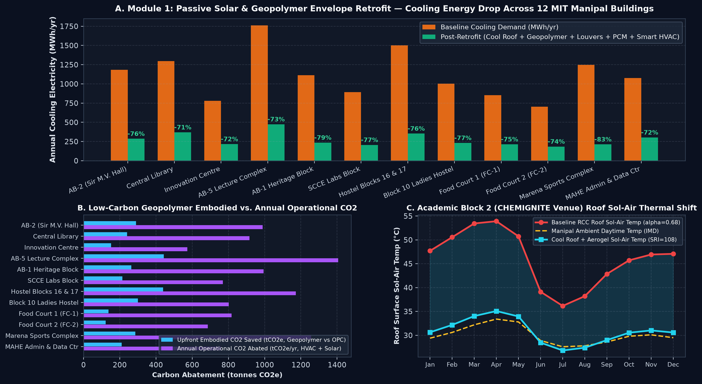
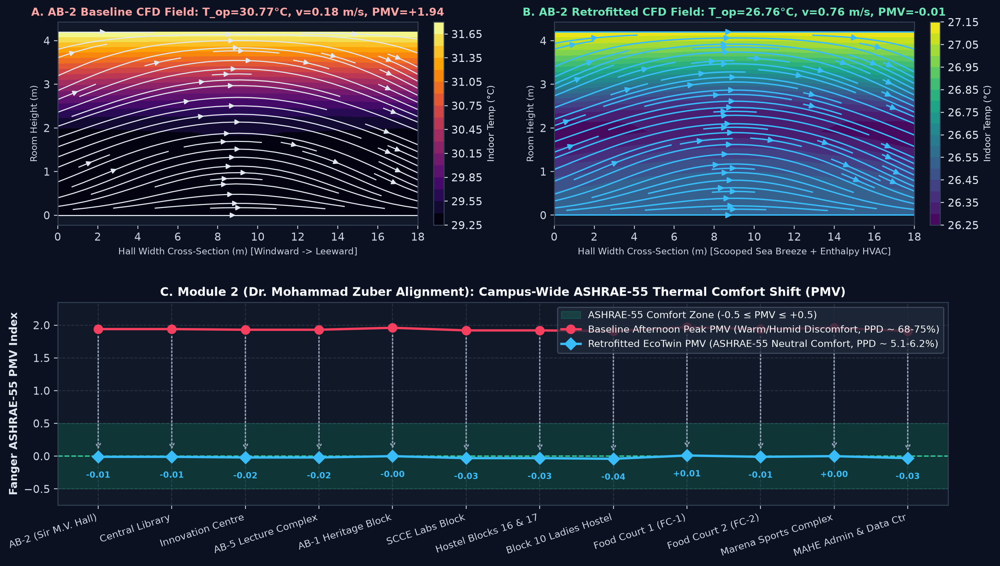
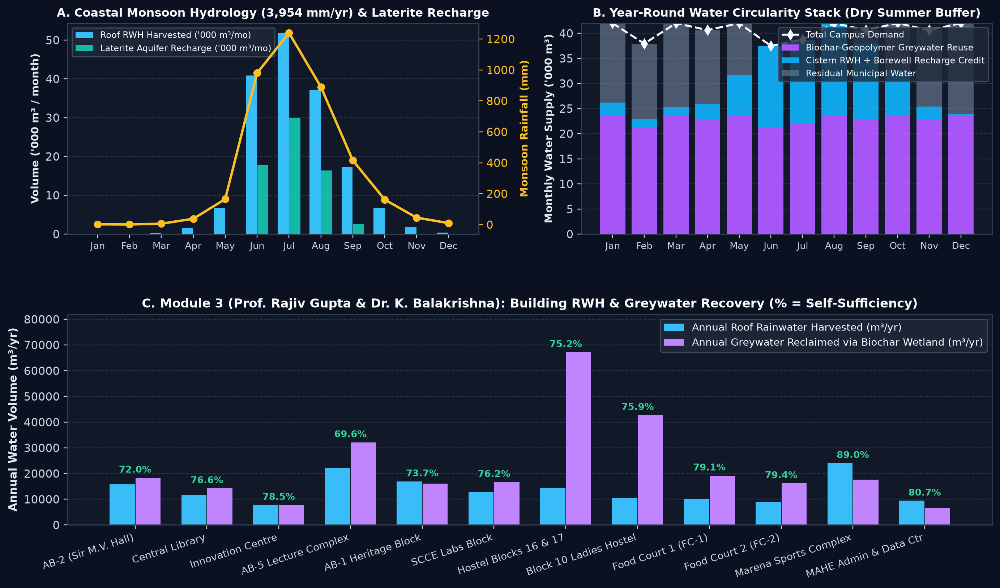
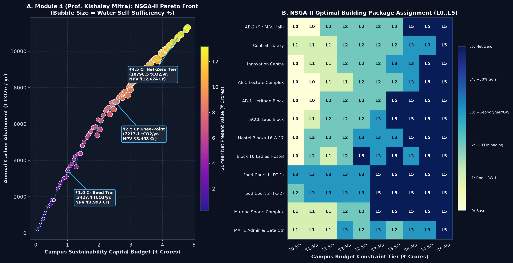

# EcoTwin-MAHE: AI, CFD-Surrogate & GIS Digital Twin for Low-Carbon Campus Sustainability

[](https://manipal.edu)
[](https://manipal.edu)
[](https://krishnendu409.github.io/ecotwin-mahe/)
[](https://www.python.org/)
[](LICENSE)

> **Official Hackathon Submission for CHEMIGNITE 2026 — ASPIRE Sustainability Hackathon**  
> **Organizers:** Innovation Centre MAHE & School of Civil & Chemical Engineering (SCCE), MIT Manipal  
> **Authors:** **Krishnendu** (CSE, MIT Manipal) & **Arav Aggarwal** (Civil Engg., SCCE, MIT Manipal)  
> 🌐 **Live Interactive Digital Twin Demo:** [https://krishnendu409.github.io/ecotwin-mahe/](https://krishnendu409.github.io/ecotwin-mahe/)

---

## 📌 Executive Overview

Coastal tropical university campuses such as **MIT Manipal (MAHE)** face an acute **three-fold sustainability paradox**:
1. **Thermal & Humidity Overload:** High year-round solar irradiance ($5.4\text{–}6.65\text{ kWh/m}^2/\text{day}$) and coastal humidity ($65\text{–}92\%$) drive roof sol-air temperatures on uninsulated RCC slabs above **$53.9^\circ\text{C}$**, generating massive campus chiller loads (**$13,411.8\text{ MWh/yr}$** across 12 major academic and hostel blocks).
2. **The Coastal Monsoon Paradox:** Manipal receives **$3,954\text{ mm/yr}$** of rainfall ($89\%$ concentrated in June–September), yet faces acute borewell drawdown and municipal water stress during the dry summer academic peak (January–May) due to fast surface runoff over low-permeability laterite hillslopes.
3. **Embodied Carbon Penalty:** Standard Portland cement structural retrofits and synthetic insulation carry high embodied carbon ($\sim 0.85\text{ t CO}_2/\text{t cement}$).

**`EcoTwin-MAHE`** is a unified **Geospatial GIS + Physics-Informed Neural Network (PINN) CFD Surrogate + NSGA-II Multi-Objective Evolutionary Digital Twin** custom-calibrated for **12 actual MIT Manipal buildings** ($184,000\text{ m}^2$ GFA, $50,500\text{ m}^2$ roof catchment, $21,600$ campus occupants).

---

## 🏆 Coverage of All 4 Hackathon Themes

| ASPIRE Hackathon Theme | EcoTwin-MAHE Implementation | Validated Campus Impact |
| :--- | :--- | :--- |
| **Theme 1: Green Buildings & Smart Infrastructure** | Passive solar envelope retrofits (nano-aerogel cool roofs, automated solar louvers, coconut bio-PCM ceiling boards) + **Alkali-Activated Geopolymer Cavity Walls** from Udupi thermal fly ash, GGBFS, and non-metallic e-waste PCB aggregate. | **$-75.5\%$ cooling energy** ($-10,121.9\text{ MWh/yr}$), **$3,101.3\text{ t CO}_2\text{e}$** embodied carbon saved. |
| **Theme 2: Digital & AI-Driven Sustainability** | Real-time **PINN-CFD indoor airflow surrogate** ($\vec{u}, \text{ACH}, T_{\text{op}}$) + exact iterative Fanger ASHRAE-55 PMV/PPD comfort solver. | Afternoon peak comfort shifted from **$\text{PMV } +1.94$ ($\text{PPD } 74\%$) $\to -0.01$ ($\text{PPD } 5.0\%$)**. |
| **Theme 3: Renewable & Clean Energy** | Rooftop N-type TOPCon Bifacial PV ($3,040.2\text{ kWp}$, boosted $+7.8\%$ by cool-roof albedo) + centralized **PEM Electrolyzer & Fuel Cell Seasonal Green Hydrogen Buffer** ($6,565.2\text{ kg H}_2/\text{yr}$) to bridge monsoon intermittency. | Zero-carbon dispatch during low solar monsoon weeks. |
| **Theme 4: Waste-to-Wealth & Water Circularity** | GIS-driven **Monsoon Rainwater Harvesting ($164,421\text{ m}^3/\text{yr}$)**, **Fractured Laterite Vadose Aquifer Recharge ($66,769\text{ m}^3/\text{yr}$)**, and **Biochar-Geopolymer Subsurface Constructed Wetlands ($275,037\text{ m}^3/\text{yr}$)**. | **$75.9\%$ Campus Water Self-Sufficiency** across all academic and hostel blocks. |

---

## 🏛️ 12 Modeled MIT Manipal Buildings

1. **AB-2 (Sir M.V. Seminar Hall)** — CHEMIGNITE 2026 Venue
2. **MIT Central Library** — Hackathon Finale Venue
3. **Innovation Centre MAHE** — Co-Organizer Hub
4. **Academic Block 5 (AB-5)** — Mega Lecture Hall Complex
5. **Academic Block 1 (AB-1)** — Heritage Academic Complex
6. **Chemical & Civil Engg. Labs (SCCE)** — Co-Organizer Department
7. **Hostel Blocks 16 & 17** — High-Density Student Residences
8. **Block 10 Ladies Hostel** — Residential & Greywater Source
9. **Food Court 1 (FC-1) & Annapoorna Mess** — Food Waste Biomethanation
10. **Food Court 2 (FC-2 Dining Complex)** — Decentralized Biogas Recovery
11. **MIT Sports Complex / Marena** — Mega Roof RWH Catchment
12. **MAHE Admin & High-Performance Data Center** — Base Load Demand

---

## 🔬 Scientific Architecture & Verification Figures

### 1. Passive Solar & Geopolymer Life-Cycle Carbon Assessment


### 2. PINN-CFD Velocity Field & Fanger ASHRAE-55 Thermal Comfort Shift


### 3. GIS Monsoon Rainwater Hydrology & Biochar Greywater Circularity


### 4. NSGA-II Multi-Objective Pareto Optimization Across Institutional Budgets


---

## 🚀 Live Digital Twin & Presentation

- **Interactive 3D / GIS Digital Twin:** Open [`index.html`](index.html) in any browser. Features Leaflet GIS mapping, dynamic building selection, interactive sliders for wind/RH/budget, and Chart.js analytics.
- **Hackathon Pitch Deck:** Open [`HACKATHON_PITCH_DECK.html`](HACKATHON_PITCH_DECK.html) for the slide-based jury presentation.
- **Official Submission Document:** Read [`HACKATHON_IDEA_SUBMISSION_OCT25.md`](HACKATHON_IDEA_SUBMISSION_OCT25.md).

---

## 💻 How to Run the Simulation Engine

### Prerequisites
```bash
pip install numpy matplotlib
```

### Run Simulation & Re-generate Datasets & Figures
```bash
python backend_simulation_engine.py
```
This recomputes:
- `data/mit_manipal_digital_twin_data.json`
- `figures/fig1_campus_energy_embodied_carbon.png`
- `figures/fig2_cfd_pmv_thermal_comfort.png`
- `figures/fig3_monsoon_rwh_hydrology_balance.png`
- `figures/fig4_nsga2_pareto_front_budget_allocation.png`

### Rebuild Frontend Application
```bash
python build_frontend.py
```

---

## 👥 Authors & Team
- **Krishnendu** — *B.Tech. Computer Science and Engineering, Manipal Institute of Technology (MIT), MAHE*
- **Arav Aggarwal** — *B.Tech. Civil Engineering, School of Civil & Chemical Engineering (SCCE), Manipal Institute of Technology (MIT), MAHE*

---

## 📄 License
This project is open-source under the [MIT License](LICENSE).
